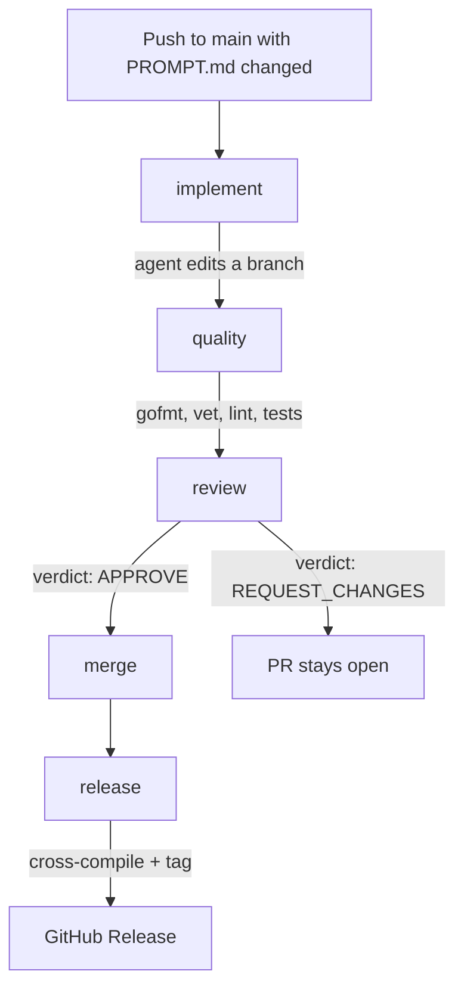

# magician

A proof of concept that turns a single `PROMPT.md` file into a reviewed, tested, and released Go application using GitHub Actions and [OpenCode](https://opencode.ai).

Push a prompt to `main`, and the pipeline writes the code, lints it, tests it, reviews the diff, merges it when the review passes, and publishes binaries. Edit the prompt and push again to evolve the app.

> This is a demo of an idea, not a production platform. Read [Risks and limitations](#risks-and-limitations) before pointing it at anything important.

## How it works



| Job | What it does |
| --- | --- |
| `implement` | Checks whether `PROMPT.md` changed, runs the `implementer` agent with the task in `.github/sdlc/implement.md`, guards protected files, validates with `go build`/`go vet`/`go test`, commits to `sdlc/run-<n>`, and opens a PR. |
| `quality` | Checks out the PR branch (or `main` when nothing changed), runs `gofmt`, `go vet`, `golangci-lint`, and `go test ./...`. |
| `review` | Sends the diff to a read-only OpenCode reviewer. The review is posted as a PR comment, and the verdict gates the merge. |
| `merge` | Squash-merges the PR only when the review returned `VERDICT: APPROVE`. |
| `release` | Builds linux/darwin/windows on amd64/arm64, writes checksums, tags `v0.1.<run_number>`, and creates a GitHub Release. |

Pushes that do not touch `PROMPT.md` skip the agent and the PR entirely, but still run lint/tests and publish a release. Trigger the workflow manually from the Actions tab to force an implementation run.

## Demo

The seed `PROMPT.md` asks for a tiny `magician` CLI:

```text
magician version
magician greet [name]
magician spell <word>
```

The first push generates `go.mod`, `cmd/magician/`, the tests, and `docs/usage.md`, then releases `v0.1.1` with six binaries.

To see the update path, change `PROMPT.md` (for example, add a `magician shout <text>` command), commit, and push. The pipeline produces a new PR and, if the review approves it, a new release.

## Repository layout

```text
.github/
  workflows/sdlc.yml      # the five-job pipeline
  sdlc/implement.md       # task prompt for the implementer
  sdlc/review.md          # task prompt for the reviewer
.opencode/
  agents/implementer.md   # protected-path rules for the coding agent
  agents/reviewer.md      # read-only reviewer agent + verdict format
opencode.json             # LiteLLM provider and model alias
.golangci.yml             # minimal golangci-lint v2 config
PROMPT.md                 # the spec the agent implements
README.md                 # this file (protected from the agent)
```

Everything under `cmd/`, `docs/`, `go.mod`, and `go.sum` is generated by the pipeline.

## Setup

### 1. Secrets and variables

Add these under **Settings → Secrets and variables → Actions**:

| Name | Kind | Value |
| --- | --- | --- |
| `LITELLM_BASE_URL` | secret | Your LiteLLM OpenAI-compatible endpoint, including `/v1` (for example `https://llm.example.com/v1`). |
| `LITELLM_API_KEY` | secret | The key for that endpoint. |
| `SDLC_MODEL` | variable | The LiteLLM model alias to use (for example `anthropic/claude-sonnet-4-5`). |

The model must support tool/function calling. OpenCode needs tools to read, edit, and run commands.

### 2. Repository settings

Under **Settings → Actions → General**:

- Set **Workflow permissions** to **Read and write**.
- Enable **Allow GitHub Actions to create and approve pull requests**.

Both are required: the workflow pushes a branch, opens a PR, comments on it, and merges it with `GITHUB_TOKEN`.

### 3. Default branch

The workflow triggers on `main`. Keep `main` as the default branch.

### 4. Provider configuration

`opencode.json` wires LiteLLM through OpenCode's generic OpenAI-compatible provider:

```jsonc
{
  "providers": {
    "litellm": {
      "name": "LiteLLM",
      "env": ["LITELLM_API_KEY"],
      "package": "@opencode/ai/providers/openai-compatible",
      "settings": { "baseURL": "{env:LITELLM_BASE_URL}" },
      "models": {
        "sdlc": { "name": "SDLC model", "modelID": "{env:SDLC_MODEL}" }
      }
    }
  }
}
```

The default model is `litellm/sdlc`. Change `SDLC_MODEL` to point at a different model without editing the workflow.

Agent restrictions live next to the agents themselves. `.opencode/agents/implementer.md` denies edits to the files that define the pipeline:

```yaml
permissions:
  - action: edit
    resource: ".github/**"
    effect: deny
  - action: edit
    resource: ".opencode/**"
    effect: deny
  - action: edit
    resource: "PROMPT.md"
    effect: deny
  - action: edit
    resource: "opencode.json"
    effect: deny
  - action: edit
    resource: "README.md"
    effect: deny
  - action: shell
    resource: "git commit *"
    effect: deny
  - action: shell
    resource: "git push *"
    effect: deny
  - action: shell
    resource: "gh *"
    effect: deny
```

`opencode.json` additionally denies reading `*.env` files for every agent in the project.

## The review gate

The reviewer agent is intentionally narrow: it can read the repository and write exactly one file, `REVIEW.md`. Shell, web, and all other edits are denied.

Its verdict format is strict:

```md
VERDICT: APPROVE
# Review
...
```

or:

```md
VERDICT: REQUEST_CHANGES
# Review
- [high] cmd/magician/main.go:42 - the empty input path panics; return an error instead.
```

The workflow posts the review as a PR comment, then parses the first `VERDICT:` line. Anything other than `APPROVE` - including a missing or malformed verdict - stops the pipeline. The PR stays open and no release is created. Fix the prompt (or the branch) and push again.

The reviewer is told to block only on correctness, spec mismatch, missing tests, security, or forbidden files. Style and naming are non-blocking by design, so the demo does not stall on whitespace opinions.

## Releases

Every green run publishes a release:

- Tag: `v0.1.<github.run_number>`
- Assets: `magician_<tag>_<os>_<arch>` for linux/darwin/windows on amd64/arm64, plus `checksums.txt`
- Notes: generated by GitHub from the merged commit and PR
- Artifact: the same `dist/` directory is uploaded to the workflow run

Version injection uses `-ldflags "-X main.version=<tag>"`, which is why the implementer must keep `var version = "dev"` in `package main`.

## Guardrails

- **Protected files** - denied in `.opencode/agents/implementer.md` and re-checked with `git status` after the agent runs. Any change to `.github/`, `.opencode/`, `PROMPT.md`, `opencode.json`, or `README.md` fails the job before a commit is made.
- **The agent does not own git** - `git commit`, `git push`, and `gh` are denied. The workflow creates the branch, commit message, PR, and merge.
- **No retrigger loop** - pushes made with `GITHUB_TOKEN` do not start new workflow runs, and commits carry `[skip ci]`.
- **Fail closed** - a missing review, malformed verdict, failed lint, or failed test all block the merge and the release.
- **Credentials** - `LITELLM_*` is exposed only on the two agent steps. `GITHUB_TOKEN` is exposed only on the steps that talk to GitHub, and checkouts use `persist-credentials: false` so the token is not left in `.git/config` during agent runs.
- **Serialized runs** - the `concurrency` group prevents two implementations from racing on `main`.

## Risks and limitations

These are real, and they are the interesting part of the demo:

- **Prompt injection is the threat model.** `PROMPT.md` is untrusted input that drives an agent with shell access and a model API key. The protected-file rules stop the agent from rewriting the workflow or granting itself more access, but they do not stop every possible exfiltration attempt (for example, echoing an environment variable into a source file). GitHub masks secrets in logs, but no network or filesystem sandbox is applied here.
- **The review is not a security boundary.** An LLM reviewer can miss bugs, approve unsafe changes, or block good ones. It is a demo gate, not a substitute for human review or deterministic policy checks.
- **LLM output is non-deterministic.** The same prompt can produce different code on different runs. The pipeline may need a re-run, a clearer prompt, or a manual fix.
- **`GITHUB_TOKEN` PRs do not trigger other workflows.** All checks live in this single workflow, so branch protection rules that require external status checks will not see them. Enabling strict protection will make the `merge` job fail; use a GitHub App to report checks or remove auto-merge.
- **The merge gate can stall.** With a strict reviewer, a minor disagreement can leave a PR open forever. Adjust `.github/sdlc/review.md` if the gate is too noisy.
- **Releases are run-number versioned.** `v0.1.<run_number>` is monotonic but not semantic, and a no-op prompt change may still produce a release if the run is green. Gate the `release` job on a diff if you want fewer tags.
- **Cost and latency.** Each prompt change makes two model calls (implement and review), plus Actions minutes for five jobs. Long agent runs can hit the 20-minute step timeout.
- **Model compatibility.** The LiteLLM alias must support tool calling and the OpenAI-compatible API shape. A chat-only model will fail at the edit step.
- **`main` is unprotected by default.** That is what makes the auto-merge work. Tightening branch protection without changing the design will break the pipeline.

### Hardening ideas for a production version

- Run the agent in a network-restricted container with a scoped, short-lived GitHub App token instead of a repo-wide `GITHUB_TOKEN`.
- Keep the model key in a proxy that logs and rate-limits requests, rather than the runner environment.
- Require human approval for the merge, and use the AI review as an additional signal rather than the gate.
- Add deterministic checks (build, vet, lint, tests, secret scanning) before any model call.
- Use semantic versioning driven by conventional commits, not the workflow run number.

## Customizing

| Want to change | Edit |
| --- | --- |
| The model | Repository variable `SDLC_MODEL`. |
| What the app should do | `PROMPT.md` and push. |
| How the implementer behaves | `.github/sdlc/implement.md`. |
| What counts as a blocking review | `.github/sdlc/review.md` and `.opencode/agents/reviewer.md`. |
| Protected paths | `.opencode/agents/implementer.md` and the guard in `sdlc.yml`. |
| Lint rules | `.golangci.yml`. |
| Release cadence or versioning | The `release` job in `.github/workflows/sdlc.yml`. |
| Auto-merge gate | Remove or condition the `merge` job; the PR will stay open for manual review. |

## Troubleshooting

| Symptom | Likely cause |
| --- | --- |
| `No model is available` or provider errors | `LITELLM_BASE_URL` is missing `/v1`, the key is wrong, or `SDLC_MODEL` does not match a LiteLLM model. |
| Agent runs but makes no edits | The model does not support tools, or the prompt was already implemented. Check the implement log. |
| `Resource not accessible by integration` | Workflow permissions are read-only, or "Allow GitHub Actions to create and approve pull requests" is disabled. |
| `gh pr create` fails with `must be run from a repository` | The checkout failed; check the earlier steps. The job sets `GH_REPO` explicitly. |
| Review job fails before posting | The reviewer did not write `REVIEW.md`. Inspect `/tmp/opencode-review.json` in the job log. |
| `merge` fails | Branch protection requires approvals or status checks that this workflow does not satisfy. |
| Release fails at `./cmd/magician` | The agent did not create the required entrypoint; the implement job should have caught this. Re-run with a clearer prompt. |
| Lint fails on generated code | Run `golangci-lint run` locally and either fix the prompt or relax `.golangci.yml`. |

## Why this exists

Most CI pipelines automate the steps after the code exists. This one automates the step where the code comes into existence, then uses ordinary CI as the safety net around it.

The shape is the point:

1. A prompt file is the spec.
2. An agent is the implementer.
3. Deterministic checks are the quality gate.
4. A second agent is the review gate.
5. A release is the default outcome of a green run.

Swap the language, the model, or the review rules, and the same skeleton works for a different stack.
